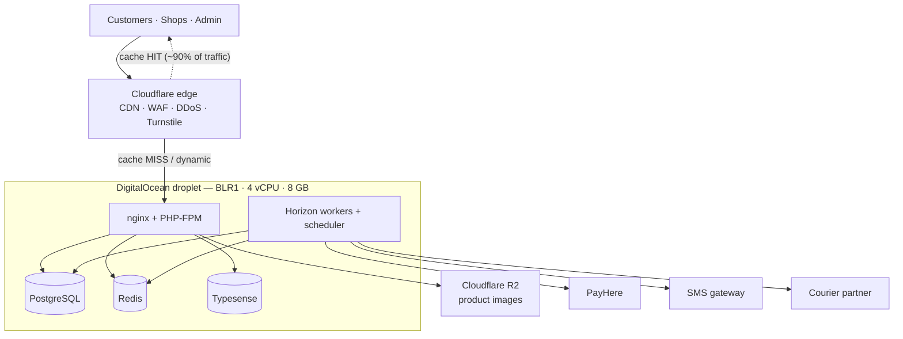
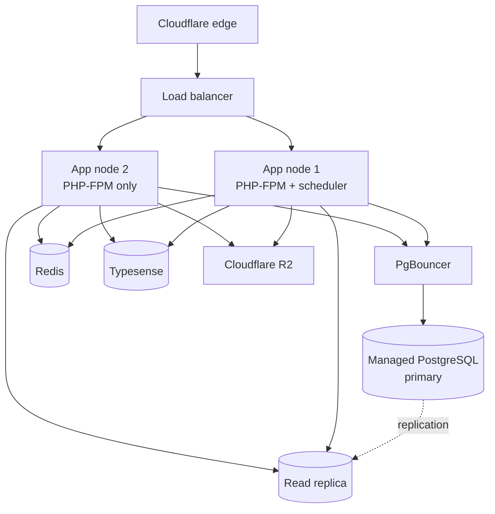
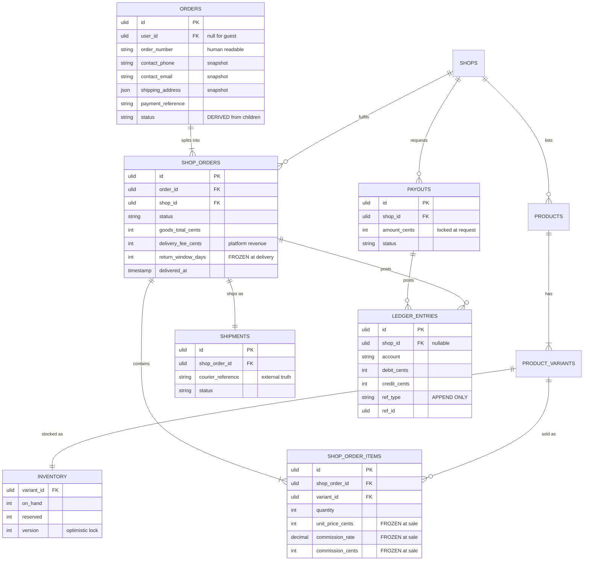
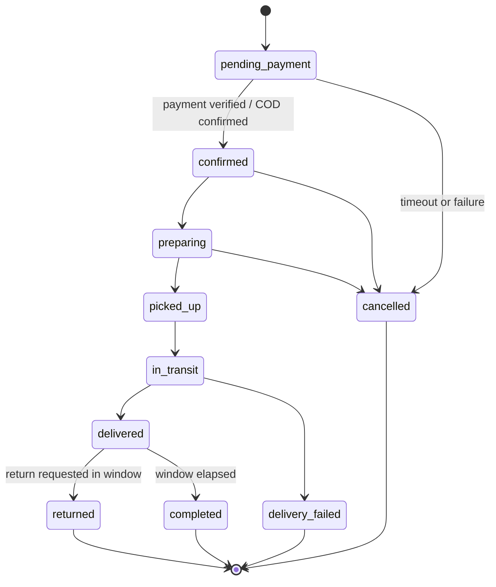
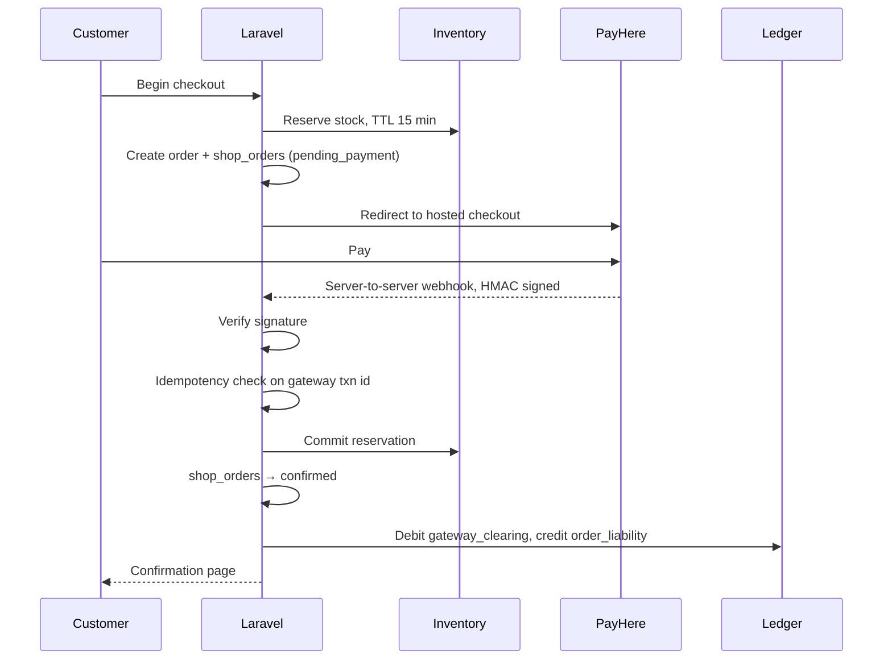

# Multi-vendor marketplace — technical plan

**Version 2.0** · Supersedes the v1.0 architecture specification.

**Market:** Sri Lanka at launch, international later.

This document is the source of truth. When generated code conflicts
with this document, this document wins.

---

## 1. What is being built

A three-sided e-commerce marketplace.

| Side | Purpose |
|---|---|
| Customer storefront | Browse, search, cart across multiple shops, checkout, track orders |
| Shop portal | Manage products, view and fulfil orders, request payouts |
| Admin console | Approve shops, moderate listings, reconcile courier remittances, manage payouts |

Later phases add an own-brand POS system and a public API for external
POS vendors to integrate against.

### Governing constraints

1. **Limited build capacity.** Scope is the primary lever. Every
   decision below optimises for shipping and maintaining this over
   years with minimal operational overhead.
2. **Money moves through the platform.** Correctness in the ledger
   outranks every other quality attribute.
3. **Latency to Sri Lanka matters.** All infrastructure sits in or near
   South Asia.

---

## 2. Decisions register

| Area | Decision | Rationale |
|---|---|---|
| Backend | Laravel (LTS), PHP 8.3+ | Batteries included; minimal integration work; generates well with AI assistance |
| Type safety | PHPStan/Larastan level 8, enforced in CI | Recovers most of the gap versus a statically typed language |
| Storefront | Blade, edge-cached | Cheapest possible page delivery; SEO by default |
| Interactivity | Alpine.js on cached pages | Client-side, zero server cost |
| Server-state UI | Livewire, restricted scope | Only where state must live server-side |
| Admin console | Filament | Saves months of build time |
| Shop portal | Filament, second panel with tenancy | Tenant isolation as a second security wall |
| Commerce core | Built in-house | No Laravel package offers multi-vendor semantics |
| Database | PostgreSQL | Row-level security, concurrency, JSON support |
| Cache / queue / session | Redis | Single dependency covering three needs |
| Search | Typesense via Laravel Scout | Cheaper and simpler than Elasticsearch at this scale |
| Object storage | Cloudflare R2 | Zero egress fees |
| Hosting | DigitalOcean, Bangalore (BLR1) | Lowest latency to Colombo with a managed-services growth path |
| Server management | Laravel Forge or Ploi | Removes a permanent ops tax |
| Edge | Cloudflare, Free tier at launch | CDN, WAF, DDoS, Turnstile |
| Payment gateway | PayHere only | Local rails; abstracted for later additions |
| Delivery | Platform-arranged via external partner | Controls customer experience; justifies commission |
| Parcel model | One parcel per shop | `shop_order` becomes the shipping unit |
| Cart | Multi-shop, split into per-shop orders | Better customer experience; costlier model |
| Commission | Percentage varying by category | Effective-dated rules |
| Payouts | Shop-requested, weekly cadence | Cadence is a setting, not a constant |
| Products | Variants required | Variant is the sellable unit |
| Customer auth | Phone OTP and email/password | One unified identity |
| Guest checkout | Allowed, OTP-verified for COD | Fraud control |
| Shop onboarding | Admin approval required | Trust gate |
| Product listings | Auto-live, post-hoc moderation | Velocity, with compensating controls |
| Languages | English only, localisation files ready | Sinhala and Tamil deferred, not designed out |
| Currency | LKR only | |

### Deliberately rejected

| Option | Why not |
|---|---|
| Next.js / headless | Second codebase, token auth complexity, third frontend alongside Filament, and no server-load benefit — cached Blade is cheaper than SSR |
| Microservices, Kubernetes | Distributed-systems cost with no scaling benefit at this size |
| Lunar, Bagisto | No multi-vendor concept, or a fork-and-maintain burden |
| MongoDB | Orders, inventory and money require ACID |
| IONOS VPS | No Asia-Pacific data centre; ~150 ms from Colombo |
| Hostinger VPS | Multi-year prepay, no managed database or load balancer, so scaling requires a provider migration |
| Cloudflare Business | Priced for compliance and SLA needs that do not apply |

---

## 3. Architecture — launch topology



Five processes on one machine, every external dependency behind an
interface.

---

## 4. Architecture — scaled topology

Triggered by the thresholds in section 16, not by a calendar.



### Rules that make this possible

Enforce from the first commit, not at migration time.

| Rule | Why |
|---|---|
| `SESSION_DRIVER=redis` | File sessions break the moment a second node exists |
| `CACHE_STORE=redis` | Same |
| All uploads to R2 via the S3 driver | `storage/app/public` is per-machine; `storage:link` is meaningless across nodes |
| DB and Redis hosts from env vars | Never assume `localhost` |
| **Scheduler cron on exactly one node** | Two crons means duplicate payouts and duplicate emails |
| `withoutOverlapping()` + Redis locks on critical jobs | Defence in depth against the above |
| Migrations run from one designated node | Concurrent `migrate` corrupts schema |
| All nodes in the same datacenter, on a private VPC | Cross-region queries make things worse, not better |
| Database firewalled to app-node private IPs only | Postgres must never face the public internet |

### Migration order

1. Vertical resize of the droplet (a reboot)
2. PostgreSQL → DigitalOcean Managed Postgres, add PgBouncer
3. Redis and Typesense → dedicated node
4. Second app node behind a load balancer
5. Read replicas, with read/write splitting in Laravel

Step 2 comes before step 4 because the database node becomes the single
point of failure the moment app nodes are redundant. Managed Postgres
buys automated failover and point-in-time recovery.

---

## 5. Request handling and caching

The load strategy is that most traffic never reaches PHP.

| Layer | Serves | Reaches Postgres |
|---|---|---|
| Cloudflare edge cache | Anonymous product, category, home pages | 0% |
| Typesense | Search and filtering | 0% |
| Redis | Repeat lookups, sessions, cart | 0% |
| PostgreSQL | Checkout, orders, dashboards | the remainder |

Roughly 90–95% of e-commerce traffic is anonymous browsing. That is the
"large crowd" requirement, and Cloudflare answers it.

### Frontend rendering rules

This boundary erodes one reasonable-looking page at a time. It is a hard
rule, not a guideline.

| Tier | Used for | Server cost |
|---|---|---|
| **Blade, edge-cached** | Home, category, product, CMS pages | None |
| **Alpine** | Galleries, variant pickers, quantity steppers, dropdowns, wishlist toggles | None |
| **Livewire** | Cart, checkout, dashboards, filters | One request per interaction |

Livewire pages cannot be edge-cached — they are dynamic and carry CSRF
tokens. **A Livewire component on a product page makes that page
uncacheable and sends every browsing visitor to PHP.**

Search and filtering is the grey area: route it through a thin cached
JSON endpoint driven by Alpine, so the surrounding page stays cacheable
and results cache separately per query.

### Livewire safety

Public properties round-trip through the browser and are
client-modifiable. Apply `#[Locked]` to anything the client must not
change, and revalidate server-side. `public $price` on a checkout
component is a vulnerability, not a convenience.

---

## 6. Module boundaries

One Laravel application, hard internal boundaries. Each module owns its
tables. Modules communicate through service classes and domain events,
never by reaching into another module's models.

| Module | Owns |
|---|---|
| `Identity` | Users, shops, roles, permissions, OTP |
| `Catalog` | Products, variants, options, categories, media |
| `Inventory` | Stock levels, reservations |
| `Cart` | Cart, cart items, price calculation |
| `Ordering` | Orders, shop orders, items, state machines |
| `Payments` | Gateway abstraction, transactions, webhooks, refunds |
| `Fulfilment` | Shipments, courier abstraction, tracking |
| `Ledger` | Accounts, entries, balances, payouts |
| `Moderation` | Flags, reports, review queue |
| `Support` | Notifications, SMS, email |

Extract a module into a separate service only when it demonstrably needs
different scaling. Not before.

---

## 7. Data model



### Non-negotiable data rules

**Money.** Every monetary value is a PHP integer in minor units. Never
`float`, never a hand-managed decimal. Use `brick/money` for all
arithmetic. Splitting a total across shops uses *allocation*, never
division — remainders are distributed, never dropped.

**Frozen values.** Copied onto the row at the moment of the event, never
looked up later:

| Value | Frozen onto | At |
|---|---|---|
| `unit_price_cents` | `shop_order_items` | sale |
| `commission_rate`, `commission_cents` | `shop_order_items` | sale |
| `delivery_fee_cents` | `shop_orders` | checkout |
| `return_window_days` | `shop_orders` | delivery |
| Contact details and address | `orders` | checkout |

Category commission rules are effective-dated so a rate change can be
scheduled without rewriting history.

**Identifiers.** ULID or UUIDv7 on everything customer- or shop-facing.
No sequential integers in URLs. Human-readable order numbers are a
separate display column.

**Variants.** The variant is the sellable unit — price, stock, SKU,
barcode, weight all live there. Cart items, order items, inventory and
future POS sync reference `variant_id`, never `product_id`. A product
with no options still has exactly one variant, so there is one code
path. Cap generated combinations per product at 200.

**Tenant scoping.** Every shop-scoped table carries `shop_id`.
PostgreSQL row-level security is enabled on all of them. A base query
scope applies tenant filtering automatically — it must be impossible to
write an unscoped query by forgetting a `where`. Filament tenancy is the
second wall. An automated test suite attempts cross-tenant access on
every shop-facing endpoint and fails the build if any succeeds.

---

## 8. Order lifecycle

`orders` is the customer's purchase and owns the single payment
reference. Its status is **derived** from children and never set
directly. `shop_orders` is the shipping unit and the ledger unit.



The `delivered → completed` transition is what releases funds from
pending to available. It fires at `delivered_at + return_window_days`,
via a scheduled job.

### Checkout and inventory



**An order is marked paid only on a verified server-to-server callback.
Never on a browser redirect.**

Inventory uses optimistic locking with a version column. Never hold
`SELECT ... FOR UPDATE` across a payment round trip. Expired
reservations are released by a scheduled job.

### Partial refunds

Refunds are issued per shop order but reverse against the **single**
parent payment transaction. Shop A cancelling while Shop B has shipped
must produce a partial gateway refund plus ledger reversals scoped to
Shop A only. Build and test this path explicitly — it is the most common
source of accounting drift in split-order marketplaces.

---

## 9. Ledger

Double-entry. Append-only. **No `balance` column anywhere, ever.**

**Accounts:** `cash`, `gateway_clearing`, `courier_clearing`,
`order_liability`, `shop_payable`, `platform_revenue`, `platform_cost`,
`customer_refunds`.

A shop's balance is a query, split two ways:

| Balance | Meaning |
|---|---|
| **Pending** | Delivered, inside the return window |
| **Available** | Return window closed — withdrawable |

Only *available* funds may be paid out. **Paying out on order placement
is the single most damaging mistake available in this system** — the
goods come back and you are chasing a vendor for money already sent.

### Worked example — COD order, one shop

Goods 5,000 · delivery 400 · category commission 8% · courier charge 250.

| Event | Debit | Credit |
|---|---|---|
| Delivery confirmed | `courier_clearing` 5,400 | `shop_payable` 4,600 |
| | | `platform_revenue` 800 |
| Courier remits | `cash` 5,150 | `courier_clearing` 5,400 |
| | `platform_cost` 250 | |

`shop_payable` 4,600 remains **pending** until
`delivered_at + return_window_days`.

**Delivery fees never enter `shop_payable`.** The platform arranges
delivery, so the fee is platform revenue and the courier charge is
platform cost.

### Prepaid variant

| Event | Debit | Credit |
|---|---|---|
| Payment verified | `gateway_clearing` | `order_liability` |
| Delivery confirmed | `order_liability` | `shop_payable` + `platform_revenue` |
| Gateway settles | `cash` + `platform_cost` (fee) | `gateway_clearing` |

### Payout flow

`requested → approved → processing → paid` (or `failed`). Amount is
locked at request time against available balance. Every transition
writes ledger entries. Cadence is a configurable setting.

### Balance checkpoints

Computing a balance as a `SUM` over all entries is fine at ten thousand
rows and slow at ten million, and it degrades every day you operate.
Write a periodic checkpoint row per shop per account, so a balance is
*last checkpoint + entries since*. Entries stay append-only and
auditable; the query stays constant-time.

**Design this in from the start.** Retrofitting checkpoints onto a live
ledger means recomputing history under load.

### Courier reconciliation

Build the remittance reconciliation screen in Phase 1. It matches a
courier remittance batch against delivered COD shop orders and surfaces
the difference. Retrofitting it means reconstructing months of cash
movements from spreadsheets.

---

## 10. Provider abstractions

Three interfaces, defined before the first implementation:

```
PaymentProvider  → initiate, capture, refund, verifyWebhook
CourierProvider  → quote, bookPickup, track, cancel
SmsProvider      → send, checkBalance
```

PayHere, the delivery partner and the SMS aggregator are each one
implementation. Adding a second must touch one class.

Store the provider's own reference on the local record. Never treat a
local ID as canonical for an external system.

The Phase 1 `CourierProvider` implementation may be manual — CSV export
and partner portal upload. A working manual process beats a broken
automated one at launch.

---

## 11. Security requirements

Ordered by consequence.

1. **Cross-tenant access is the top risk.** Shop A reading Shop B's
   orders by changing an ID. Defences in section 7: automatic tenant
   scoping, row-level security, opaque IDs, Filament tenancy, and an
   automated cross-tenant test suite.
2. **Card data never touches the server.** PayHere hosted checkout or
   iframed fields only. Keeps PCI scope at SAQ-A.
3. **Payment webhooks:** HMAC signature verified; handlers idempotent
   via a unique constraint on the gateway transaction ID. Gateways
   retry; double-crediting is a real and expensive bug.
4. **OTP abuse is an active fraud target.** Attackers pump SMS traffic
   to numbers they profit from and you pay per message. Rate limit per
   phone, per IP and per device separately — **in Laravel, not
   Cloudflare**, because Cloudflare's counting on these plans is
   IP-based and cannot see the phone number. Five-minute expiry, three
   attempts, exponential backoff, Turnstile on the form, and a spend
   alarm on the SMS account.
5. **Guest COD:** phone OTP required, order value capped.
6. **Uploads:** validate magic bytes, re-encode server-side, cap
   dimensions, strip EXIF, serve from a separate domain.
7. **Auth:** argon2id. Mandatory MFA for admin, offered to shops. One
   `users` table with phone and email each nullable and each unique,
   at least one required, and an explicit account-link flow.
8. **PHPStan/Larastan level 8 enforced in CI.** Not optional.
9. Redis bound to `127.0.0.1` with `requirepass` set. Public Redis is
   found by scanners within hours.
10. Immutable audit log on every admin action and ledger entry.
11. Secrets in the Forge environment or a secrets manager. Never in the
    repository.
12. Independent penetration test before public launch.
13. Sri Lanka PDPA applies. Build data export and deletion as features
    now, not later.

### Product moderation controls

Listings go live without approval, so compensating controls are
required: a moderation queue sorted by newness, keyword and
price-anomaly flags, a customer report button, a one-click "unpublish
this shop's entire catalogue" action, and a trust level on the shop so a
new shop's first ten listings are reviewed.

---

## 12. Infrastructure

### Server

| Item | Value |
|---|---|
| Provider | DigitalOcean |
| Region | BLR1 (Bangalore) — ~35 ms from Colombo |
| Plan | `s-4vcpu-8gb` |
| Resources | 4 vCPU · 8 GB RAM · 160 GB SSD · 5 TB transfer |
| OS | Ubuntu 24.04 LTS |
| Cost | $48/month |

### Memory allocation

Default configs assume each service owns the machine. Tune all of them.

| Service | Budget | Key setting |
|---|---|---|
| OS + nginx | 600 MB | — |
| PHP-FPM | 1.4 GB | `pm.max_children = 20` |
| Horizon workers | 500 MB | 6 processes |
| PostgreSQL | 2.0 GB | `shared_buffers = 2GB` |
| Redis | 768 MB | `maxmemory 768mb` |
| Typesense | 1.0 GB | — |
| Headroom | ~1.7 GB | — |

**PostgreSQL:** `shared_buffers 2GB`, `effective_cache_size 5GB`,
`work_mem 16MB`, `maintenance_work_mem 512MB`, `max_connections 100`,
`random_page_cost 1.1` (the default 4.0 assumes spinning disks and will
make the planner avoid indexes it should use).

**Add 4 GB swap with `vm.swappiness = 10`.** DigitalOcean droplets ship
with none. Without swap, a memory spike invokes the OOM killer and it
will choose PostgreSQL.

**Redis:** enable AOF with `appendfsync everysec` — the queue holds real
work, and RDB-snapshot-only will lose jobs on restart. Use separate
databases: `db 0` for queue and sessions with `noeviction`, `db 1` for
cache with `allkeys-lru`. A shared LRU instance will evict a pending
payout job to cache a product page.

### Cloudflare

| Stage | Plan | Cost |
|---|---|---|
| Launch | Free | $0 |
| Real payment volume | Pro | $20/mo annual, $25 monthly |

Free covers DNS, unlimited CDN bandwidth, unmetered DDoS, Universal SSL,
cache rules, a managed WAF ruleset, Bot Fight Mode, Turnstile, 5 custom
rules and 1 rate limiting rule.

**The critical item is a config, not a purchase.** Cloudflare does not
cache HTML by default. Create a **Cache Rule** that caches HTML for
anonymous visitors and bypasses when a session cookie is present.
Without it, every product page hits PHP and the entire load strategy is
void. Verify `cf-cache-status: HIT` on a logged-out product page before
launch.

Use **Turnstile** on registration, login, OTP request and guest
checkout.

Upgrade to Pro for the full OWASP managed ruleset once real money is
moving. Business at $200/month is priced for compliance needs you do not
have. Billing is **per domain** — keep everything under one root domain
with subdomains.

### Running cost at launch

| Item | Cost |
|---|---|
| Droplet (`s-4vcpu-8gb`) | $48 |
| Laravel Forge | $12 |
| Staging | $0 — existing VPS |
| Backups | ~$1 — own dumps to R2 |
| Cloudflare | $0 — Free tier |
| R2 (~100 GB) | ~$2 |
| Sentry | $0 — free tier |
| **Total** | **~$63/month** |

Plus usage-based SMS and PayHere's transaction percentage. See section
13 for what was cut, what was not, and when to add each cost back.

### Backups

Use `spatie/laravel-backup`, scheduled, dumping PostgreSQL to R2.

| Setting | Value |
|---|---|
| Frequency | Every 6 hours at launch; hourly once order volume is meaningful |
| Retention | 7 daily, 4 weekly, 6 monthly |
| Encryption | Password-protected archive — the dump holds customer phone numbers, emails and addresses |
| Destination | R2, a different provider from the server |

Three things decide whether this actually works:

1. **Failure notification is mandatory**, plus a dead-man's switch
   (Healthchecks.io free tier) that alerts when the job *doesn't* run.
   A silently stopped backup is worse than none, because you believe
   you are covered.
2. **Rehearse the restore on staging before launch.** An untested
   backup is a hypothesis.
3. **Take one manual DigitalOcean snapshot after provisioning**, and
   refresh it after significant server changes. This covers
   whole-machine rebuild, which a database dump does not. Roughly
   $0.06/GB/month.

Also back up `.env` and secrets separately and encrypted — they are not
in git and not in the dump. Enable object versioning on the R2 bucket
so an accidental delete is recoverable.

`pg_dump` on a live database is safe; MVCC means it takes no locks. Use
`--format=custom`.

### Observability

Sentry, structured logging, uptime monitoring, Horizon dashboard, and
`pg_stat_statements` enabled in production from day one.

---

## 13. Launch cost plan

Pre-revenue, the goal is the lowest monthly cost that does not risk
data, uptime, or build velocity. Every cut below is reversible in
minutes.

### What changed

| Item | Full | Lean | How |
|---|---|---|---|
| Droplet | $48 | $48 | **Not cut** |
| Laravel Forge | $12 | $12 | **Not cut** |
| DigitalOcean backups | $9.60 | ~$1 | Own dumps to R2 + one manual snapshot |
| Staging droplet | $24 | $0 | Use the existing spare VPS |
| Cloudflare | $0 | $0 | Free tier |
| R2 | $2 | $2 | **Not cut** |
| **Total** | **~$96** | **~$63** | |

### What was deliberately not cut

**The 8 GB droplet.** PostgreSQL, Redis, Typesense and PHP-FPM need the
space (section 12). A swapping server is a slow server, and the memory
allocation table has no slack in it. If you absolutely must reach the
$24 tier, the lever is deferring Typesense and using PostgreSQL
full-text search at launch — that frees 1 GB and makes 4 GB workable.
Search quality suffers and you add Typesense back later. It is a real
option, just a worse one.

**Backups.** Reduced in cost, not in coverage. The database is the only
irreplaceable asset in this system.

**Cloudflare.** Already free, and the cache rule that makes the whole
load strategy work costs nothing.

**Laravel Forge.** See below.

### Why Forge stays in the lean budget

Forge provisions nginx, PHP-FPM, PostgreSQL, Redis,
supervisor and certbot, then handles zero-downtime deploys, SSL renewal,
Horizon management and firewall config.

Self-managing would save $12/month at the cost of roughly 4–8 hours of
one-time setup plus a permanent maintenance tax. The ongoing cost is
attention, not work: when something breaks on a Friday night you are
debugging nginx instead of shipping. $12 to remove that is the cheapest
line item in this document.

Ploi does the same job for roughly half the price if the difference
matters.

Two things to get right regardless of who manages the server:

1. **Keep provisioning reproducible.** Forge's server configuration is
   recoverable, but anything you add by hand over SSH is not. Commit
   custom setup as a script.
2. **Verify certbot auto-renewal** with `certbot renew --dry-run`. A
   silently expired certificate on an e-commerce site is a bad morning.

### Staging on the spare VPS

Free, and correct, provided:

| Requirement | Why |
|---|---|
| **Match versions exactly** — OS, PHP, PostgreSQL major, extensions | A version mismatch passes migrations that fail in production. False confidence is worse than no staging |
| **Scrub personal data** on copy-down, or lock the box down like production | Staging holds real customer data and is your PDPA liability too |
| `MAIL_MAILER=log`, null SMS driver, PayHere **sandbox** credentials | A staging job that texts real customers is a genuinely bad afternoon |
| Separate database, Redis and R2 bucket | Never let staging touch anything production owns |
| HTTP basic auth, `noindex`, blocking `robots.txt` | Otherwise customers find your test store in Google |

Specs need not match — you are testing correctness, not load.

### When to add each cost back

| Trigger | Add | Cost |
|---|---|---|
| Real payment volume | Cloudflare Pro — OWASP managed ruleset | $20/mo |
| Spare VPS reclaimed, or version drift appears | Dedicated staging droplet, destroyed when idle | ~$2/mo |
| Order volume meaningful | Hourly backups instead of 6-hourly | pennies |
| Postgres cache hit ratio below 99% | Managed PostgreSQL | see section 4 |

---

## 14. Database load strategy

Apply in this order. Most "the database can't cope" problems are query
problems.

1. **Query quality.** A missing index on `shop_orders.shop_id` is a
   hundred-fold difference no hardware fixes. Read
   `pg_stat_statements` monthly. Watch Laravel eager loading, and watch
   Filament tables — they produce N+1 queries very easily.
2. **Redis cache-aside** on product detail, category trees, shop
   profiles, commission rules. Invalidate on model events.
3. **Read replicas** with Laravel's read/write connection split. Set
   `sticky => true` so a request reads its own write from the primary —
   otherwise a shop adds a product and it appears missing.
4. **PgBouncer** in transaction pooling mode.

### Two hot spots the above does not solve

**Inventory** cannot be cached or replicated away. Flash sales contend
on one stock row. Optimistic locking, short transactions,
reservation-with-TTL. If a single SKU becomes genuinely hot, move its
counter to Redis with atomic decrements and reconcile asynchronously —
but not before you need it.

**Ledger balances** — see section 9, balance checkpoints.

Partition or archive `orders` and `ledger_entries` by date once large.
Nobody scans two years of history interactively.

---

## 15. Build sequence

Scope is the main lever available here.

### Phase 1 — launchable marketplace

Identity (phone OTP + email), shop onboarding with admin approval,
catalogue with variants, Typesense search, multi-shop cart, checkout,
PayHere, COD, order splitting, **the ledger**, shipment records,
Filament admin and shop panels, courier remittance reconciliation,
payout requests.

**Build the ledger first and test it hardest.** It is the only part of
this system where a bug is unrecoverable — a broken checkout can be
fixed, six months of unrecorded vendor balances cannot be reconstructed.

If a date matters more than scope, cut reviews, promotions and shop
analytics first. None block a working transaction.

### Phase 2

Returns and refunds, courier API integration, moderation tooling,
promotions and discounts, reviews, shop analytics, notifications.

### Phase 3

Own POS system, public POS API, international payments, advanced
reporting.

### Deferred by design

Microservices · Kubernetes · multi-language storefront · multi-currency
· custom-built shop dashboard · parcel consolidation · mobile apps ·
headless frontend.

---

## 16. Scaling triggers

Act on the first that fires. Do not scale on nerves.

| Signal | Action |
|---|---|
| PHP-FPM listen queue above zero, sustained | More workers, then more CPU |
| CPU steal time consistently high | Move to a dedicated-CPU tier |
| Postgres cache hit ratio below 99% | More RAM, then Managed Postgres |
| Redis `evicted_keys` above zero | Raise `maxmemory`, then dedicated node |
| Connection count nearing `max_connections` | Add PgBouncer |
| p95 response time above 500 ms | **Investigate first** — usually a missing index, not hardware |
| Slow query log entries above 100 ms | Index or rewrite the query |
| Replication lag rising | Rebalance read routing |

Load test with k6 before launch, simulating realistic
browse-to-checkout ratios. "No downtime under load" is a testable
claim.

---

## 17. Open items

| Item | Status |
|---|---|
| Payout cadence | Weekly for now; must be a configurable setting |
| Return window bounds | Enforce platform min/max around the per-shop value; suggested 3–14 days |
| Delivery partner | Selection pending; confirm whether a usable API exists |
| SMS aggregator | Selection pending |
| International payments | Likely requires a foreign entity (Singapore, UK, US). A legal and banking decision, not a technical one |
| Multi-shop checkout conversion | Monitor abandonment on multi-shop carts; if poor, cap delivery fees rather than changing the parcel model |
