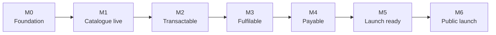
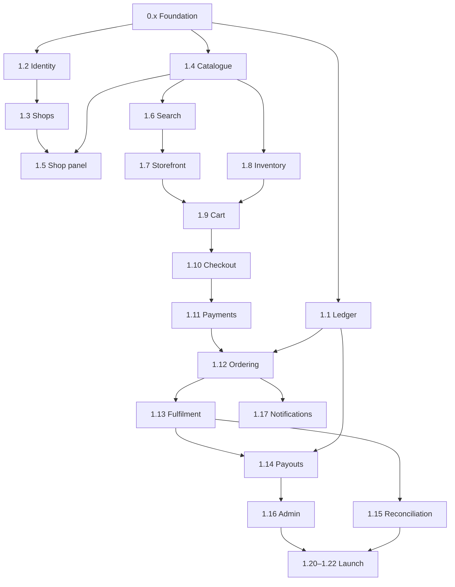

# Multi-vendor marketplace — work breakdown

**Version 1.0** · Companion to the technical plan v2.0.

Estimates are in **ideal days** — focused, uninterrupted work on that
item alone, excluding meetings, context switching and waiting on third
parties. Section 8 converts these to calendar time.

---

## 1. How this is sequenced

Three rules drive the order below.

**The ledger comes first.** It is the only component where a defect is
unrecoverable. Everything that moves money depends on it, and
retrofitting append-only semantics or balance checkpoints onto live data
is far more expensive than building them up front.

**Foundation before features.** Tenant scoping, the money type and
provider contracts have to exist before the first feature uses them.
Added later, every earlier feature needs rewriting.

**Transactable before complete.** The first real milestone is a customer
placing and paying for an order, even with an ugly storefront and no
admin tooling. That path proves the architecture. Polish follows.

---

## 2. Milestones

| ID | Milestone | Demonstrable when |
|---|---|---|
| **M0** | Foundation | Empty app deploys to staging through CI, with tenant scoping, money type and provider fakes in place |
| **M1** | Catalogue live | A shop can be approved, list a product with variants, and a customer can find it via search and browse |
| **M2** | Transactable | A customer completes a multi-shop checkout and pays through PayHere; orders split correctly |
| **M3** | Fulfilable | Orders move through the full state machine to delivered, and the ledger posts correctly at each step |
| **M4** | Payable | A shop requests a payout against available balance, and courier remittances reconcile |
| **M5** | Launch ready | Load tested, penetration tested, PDPA features present, runbook written, restore rehearsed |
| **M6** | Public launch | Live with real shops |

---

## 3. Phase 0 — Foundation

**20 ideal days.** No user-visible output. Skipping any of this means
rewriting later.

| WBS | Work package | Days | Depends on |
|---|---|---|---|
| 0.1 | Repo, branching, CI pipeline (PHPStan L8, Pint, Pest), module skeleton | 3 | — |
| 0.2 | Server provisioning via Forge; PostgreSQL, Redis, Typesense install and tuning | 4 | — |
| 0.3 | Cloudflare DNS, SSL, **cache rule**, Turnstile keys; staging on spare VPS | 2 | 0.2 |
| 0.4 | Backup job, restore rehearsal, Sentry, uptime monitoring | 2 | 0.2 |
| 0.5 | Core primitives: ULID base model, money value object, audit log | 3 | 0.1 |
| 0.6 | **Tenant scoping**: global scope, PostgreSQL RLS, cross-tenant test harness | 3 | 0.5 |
| 0.7 | Provider contracts (`PaymentProvider`, `CourierProvider`, `SmsProvider`) plus fake implementations for tests | 2 | 0.1 |
| 0.8 | Design system: Tailwind tokens, fonts, base Blade components | 4 | 0.1 |

**0.6 is the one not to compress.** The cross-tenant test harness built
here is what makes every later feature safe by default. Built later, it
is an audit of existing code instead of a guardrail.

---

## 4. Phase 1 — MVP

**165 ideal days.** Ordered by dependency, not by visibility.

### 4.1 Money and identity — 24 days

| WBS | Work package | Days | Depends on |
|---|---|---|---|
| 1.1 | **Ledger core**: accounts, append-only entries, posting service, pending/available balances, checkpoints, full test suite | 10 | 0.5 |
| 1.2 | Identity: users table, phone OTP, email/password, account linking, Turnstile, layered rate limiting | 10 | 0.6 |
| 1.3 | Shop onboarding, admin approval, trust levels, RBAC | 4 | 1.2 |

Build 1.1 before anything else in this phase. Every money-touching
feature posts through its service, and a stable posting interface means
later features cannot invent their own accounting.

### 4.2 Catalogue and discovery — 46 days

| WBS | Work package | Days | Depends on |
|---|---|---|---|
| 1.4 | Categories, products, options, **variants**, media upload to R2 | 14 | 0.6 |
| 1.5 | Shop panel (Filament): product CRUD, variant generator with cap, order views | 10 | 1.3, 1.4 |
| 1.6 | Search: Typesense collection at **product level**, Scout integration, queued indexing, alias-swap reindex, facets | 8 | 1.4 |
| 1.7 | Storefront: home, category, product, shop pages; Alpine interactivity; SEO, sitemap, structured data | 14 | 0.8, 1.6 |

Category browse routes through Typesense (1.6), not PostgreSQL — so 1.7
depends on 1.6, not the other way round.

### 4.3 Transaction path — 42 days

| WBS | Work package | Days | Depends on |
|---|---|---|---|
| 1.8 | Inventory: stock per variant, reservation with TTL, optimistic locking, release job | 6 | 1.4 |
| 1.9 | Multi-shop cart (Livewire), guest and authenticated | 8 | 1.7, 1.8 |
| 1.10 | Checkout: addresses, per-shop delivery fees, order summary | 8 | 1.9 |
| 1.11 | Payments: PayHere implementation, hosted checkout, **webhook HMAC + idempotency**, COD with OTP gate and value cap | 10 | 0.7, 1.10 |
| 1.12 | Ordering: order and shop_order split, state machines, derived parent status, order history, guest lookup | 10 | 1.1, 1.11 |

**Milestone M2 lands here.** This is the architecture-proving sequence —
if anything is structurally wrong, it surfaces in 1.11 and 1.12.

### 4.4 Fulfilment and settlement — 18 days

| WBS | Work package | Days | Depends on |
|---|---|---|---|
| 1.13 | Shipments, `CourierProvider` manual CSV implementation, tracking updates, delivery confirmation triggering ledger posting and return window | 7 | 0.7, 1.12 |
| 1.14 | Payouts: request flow, state machine, available-balance guard, admin approval, ledger postings | 6 | 1.1, 1.13 |
| 1.15 | Courier remittance import, matching, variance reporting | 5 | 1.13 |

### 4.5 Operations and launch — 35 days

| WBS | Work package | Days | Depends on |
|---|---|---|---|
| 1.16 | Admin console (Filament): shops, approvals, orders, ledger views, payout queue | 8 | 1.14 |
| 1.17 | Notifications: SMS provider implementation, email templates, lifecycle triggers | 5 | 0.7, 1.12 |
| 1.18 | Moderation: queue, keyword and price-anomaly flags, customer reports, bulk unpublish | 4 | 1.5 |
| 1.19 | PDPA: data export and deletion | 3 | 1.2 |
| 1.20 | Load testing (k6), query tuning, cache verification | 5 | all |
| 1.21 | Independent penetration test and remediation | 6 | all |
| 1.22 | Runbook, restore rehearsal, launch checklist | 4 | all |

**1.21 needs calendar booking well in advance** — it depends on an
external party and is the single most common cause of launch slippage
in this plan.

---

## 5. Dependency map

**Longest dependency chain:** Foundation → Catalogue → Search →
Storefront → Cart → Checkout → Payments → Ordering → Fulfilment →
Payouts → Admin → Launch. Roughly **109 days** of unavoidably
sequential work. Nothing shortens this except cutting scope from the
chain itself.

Off the chain and therefore deferrable under pressure: 1.18 moderation,
part of 1.16 admin, and storefront polish within 1.7.

---

## 6. Phase 2 — post-launch

**~60 ideal days.** Not scheduled until M6 is behind you and real usage
data exists.

| WBS | Work package | Days |
|---|---|---|
| 2.1 | Returns and refunds, including partial refunds against a single payment | 12 |
| 2.2 | Courier API integration replacing the manual implementation | 8 |
| 2.3 | Promotions and discounts | 10 |
| 2.4 | Reviews and ratings | 8 |
| 2.5 | Shop analytics | 8 |
| 2.6 | Advanced moderation tooling | 6 |
| 2.7 | Performance work driven by real traffic | 8 |

**2.1 is the one that may not wait.** Partial refunds are listed as
Phase 2, but the moment a real customer wants to cancel one shop's items
from a three-shop order, you need it. Expect to pull this forward within
weeks of launch, and leave room for it.

---

## 7. Phase 3 — expansion

Not estimated in detail; scope will have changed by then.

| WBS | Work package | Rough |
|---|---|---|
| 3.1 | Own POS system | 40–60 days |
| 3.2 | Public POS API: OpenAPI spec, OAuth2, idempotency, webhooks, sandbox | 25–35 days |
| 3.3 | International payments | depends on the entity decision |
| 3.4 | Multi-language (Sinhala, Tamil) | 15–20 days |
| 3.5 | Mobile applications | separate project |

---

## 8. Schedule

| Phase | Ideal days |
|---|---|
| Phase 0 — Foundation | 20 |
| Phase 1 — MVP | 165 |
| **To launch** | **185** |
| Phase 2 | ~60 |

**Ideal days are not calendar days.** A realistic conversion factor is
0.6–0.7 — the rest goes to debugging, rework, waiting on third parties,
and everything that is not building.

| Working pattern | Calendar estimate to M6 |
|---|---|
| Full-time focus | 9–11 months |
| Four productive days a week | 12–14 months |
| Part-time alongside other work | 18–24 months |

Add a **15% contingency** on top. The estimates above assume no major
rework, and something in the transaction path always surprises.

### Cutting to a faster launch

If a date matters more than scope, these come out first. They are off
the critical chain or can be handled manually at low volume.

| Cut | Saves | Cost of cutting |
|---|---|---|
| Moderation tooling (1.18) | 4 d | Manual review; acceptable under ~50 shops |
| Shop analytics (Phase 2) | — | Already deferred |
| Storefront polish within 1.7 | ~5 d | Looks plainer at launch |
| Admin console depth (1.16) | ~4 d | More database work by hand |
| Typesense → PostgreSQL FTS | ~4 d | Worse search; **also frees 1 GB RAM** |

That reaches roughly **165 days**. Below that you are cutting into the
transaction path or the ledger, which is not a trade worth making.

### Do not cut

Penetration test (1.21) · load test (1.20) · restore rehearsal (1.22) ·
ledger tests within 1.1 · the cross-tenant test harness (0.6).

Each of these is cheap now and expensive as an incident.

---

## 9. Risks

| Risk | Impact | Mitigation |
|---|---|---|
| Ledger design flaw found after real orders exist | Severe — unrecoverable accounting | Build first (1.1), test hardest, rehearse postings against worked examples before 1.12 |
| Courier partner has no usable API | Moderate — manual fulfilment ops | Already assumed; 1.13 ships a manual implementation behind the interface |
| Penetration test booked too late | Delays launch by weeks | Book during Phase 1, not after |
| Partial refunds needed sooner than Phase 2 | Moderate | Leave 12 days of post-launch capacity unallocated |
| Variant model changed after launch | Severe — touches every order table | Decision is locked in the technical plan; do not revisit |
| Scope growth during Phase 1 | Schedule slip | New ideas go to a Phase 2 list, not into the current phase |
| PayHere integration surprises | Moderate | Build against sandbox early in 1.11, not at the end |

---

## 10. Tracking

Track at **work-package level**, not task level — 40 WBS items is a
readable board; 400 subtasks is an administrative burden.

Three states only: not started, in progress, done. "Done" means merged,
tested, deployed to staging, and passing CI including PHPStan level 8
and the cross-tenant suite. A work package that is "done except tests"
is not done — that convention is what keeps the estimates meaningful.

Re-estimate the remaining phase at each milestone. Estimates made before
M2 are guesses; estimates made after it are informed.
